<p align="center">
  
</p>

<h1 align="center">Neither substitutable for the other</h1>

<p align="center">
  <a href="https://github.com/lihuanlz/Neither-substitutable-for-the-other/actions/workflows/ci.yml"></a>
  
  
  
  
</p>

## The finding

**There is no common scale on which to put human and machine contribution, and the reason is structural rather than a matter of measurement error.**

A machine compresses a residual toward a floor it cannot pass. Its total gain is capped at `log(e₀/Φ)` and does not improve with additional inference steps. A human moves the floor itself, and that gain is unbounded. One side has a ceiling, the other does not, and two quantities like that cannot share a ruler.

Three consequences fall out of the same currency, and each is a machine-checked theorem rather than an intuition:

- **Headcount saturates.** Under a max-type coalition the marginal member earns exactly zero and costs strictly more.
- **Corpus size saturates.** Only the single item certifying the lowest floor determines the bound that is attainable at all.
- **Provenance cannot certify anything.** The floor function provably never reads the source label, so tagging an item human or machine changes no bound.

## What is machine-checked

164 theorems and 20 worked examples across thirteen Lean 4 modules, against Mathlib. Zero `sorry`. The axiom audit resolves every declaration against `Classical.choice`, `Quot.sound` and `propext` and nothing else, and it runs in CI on every push.

```powershell
lake build
python tools\audit_axioms.py     # axiom dependencies for all 164 declarations
python tools\check_metadata.py   # CITATION.cff / .zenodo.json / README agreement
```

## What machine checking did to the argument

This is the part that is not visible anywhere else, and it is why the formalization was worth doing rather than asserting.

Checking the proofs falsified a confusion-matrix inequality from an earlier draft, forced a total-variation floor into the residual term, reversed two monotonicity directions we had asserted, and refuted one of our own claims on first attempt. Those reversals are reported in the paper rather than patched out quietly.

It also settled the direction of causality between the two sides, which the prose had left vaguer than it should have been: **the human's layer move creates the machine's budget, and the machine cannot move the layer.** The dependence has a direction, and that direction is what non-substitutability means here.

## What would falsify this

Each claim carries the observation that would refute it. None of them requires the formal layer to be wrong.

- The two-operator separation fails on a task where a machine raises the floor repeatedly with the human out of the loop.
- The coalition results fail on two teams matched on their best member where the weaker member still moves the joint outcome.
- The calibration result fails on data where the fitted bar transfers, in distribution, to the population it is scored on.
- The max-type coalition assumption is not proven here, and it is a seam rather than a lemma.

The model commits to a max-type coalition, to a corpus read as a set rather than a stream, and to a positive floor `Φ` that no theorem here establishes. Those are stated commitments, not oversights.

## Modules

<details>
<summary><b>13 modules, and what each one settles</b></summary>

| Module | What it settles |
|---|---|
| `Basic.lean` | Total variation, optimal testing, and the ceiling any detector hits |
| `HypothesisTest.lean` | Set-form total variation theorem, Neyman–Pearson power bound |
| `Contamination.lean` | TV mixing, its exponential law under repeated contamination, a collapse bound |
| `VerifyBudget.lean` | The optimal verification budget is capped independently of reviewer reliability |
| `Refinement.lean` | Observation-layer equivalence classes, and the two currencies formalized |
| `Value.lean` | Separability of influence and value: any reflection-invariant proxy is blind to the split |
| `Incommensurable.lean` | The two are not linearly convertible, stated regime by regime |
| `Calibration.lean` | The sign of the estimated minimum contribution is not identified |
| `Coverage.lean` | Coverage function, submodularity, single-sample marginal gain |
| `Fragmentation.lean` | Adding members earns zero and costs; waiting is worth non-increasingly more |
| `Corpus.lean` | Dilution invariance and the selection ceiling: only the single best item counts |
| `Tagged.lean` | Provenance labels are not read by the floor, so they cannot certify a bound |
| `Examples.lean` | Exact rational worked examples |

`Fragmentation`, `Corpus` and `Tagged` are side topics. `Tagged` and
`Contamination` are formalized in separate carriers and there is no map between
them, so the contamination rate and the provenance vocabulary are kept apart on
purpose.

</details>

## Repository layout

```
Provenance.lean            Main entry point (module guide + reproduction notes)
Provenance/                13 Lean modules
tools/audit_axioms.py      Axiom-dependency audit over the 164 theorems (CI gate)
tools/check_metadata.py    CITATION.cff / .zenodo.json / README citation check (CI gate)
tools/strip_bom.py         Strips UTF-8 BOMs from Python sources
.github/workflows/ci.yml   GitHub Actions: Lean build, axiom audit, metadata
assets/                    Header figure (SVG)
CITATION.cff               Machine-readable citation metadata
.zenodo.json               Zenodo archive metadata (a release mints a versioned DOI)
LICENSE                    MIT
lakefile.lean, lean-toolchain, lake-manifest.json
```

## CI

Every push to `main` and every pull request runs one job:

1. `lake build` via [leanprover/lean-action](https://github.com/leanprover/lean-action), which installs the pinned toolchain and fetches the Mathlib cache before compiling
2. `tools/audit_axioms.py`, confirming all 164 declarations resolve against only `Classical.choice`, `Quot.sound` and `propext`, with zero `sorryAx`
3. `tools/check_metadata.py`, confirming the citation files and the README agree

A passing `lake build` only says the kernel accepted the proofs. The axiom audit is what stops a claim from being quietly weakened by a `sorry`.

## Citation

> **Two saturating operators: non-substitutability of human and machine
> contribution in AI-assisted discovery.** *Huan Li.* Independent Researcher,
> 2026. [ORCID 0009-0004-2695-6825](https://orcid.org/0009-0004-2695-6825).
> DOI: [10.5281/zenodo.23321578](https://doi.org/10.5281/zenodo.23321578)

Cite the concept DOI rather than a version DOI: it resolves to the newest
archived version, so the citation stays correct as new versions are published.

The article is CC-BY-4.0. The code in this repository is MIT; see
[`LICENSE`](LICENSE). `tools/check_metadata.py` fails if the two are collapsed
into one. The Lean sources behind the article are the ones in this repository.

<!--
  Scholarly metadata for crawlers. This describes the Zenodo record, not a file
  in this repository.
-->
<script type="application/ld+json">
{
  "@context": "https://schema.org",
  "@type": "ScholarlyArticle",
  "headline": "Two saturating operators: non-substitutability of human and machine contribution in AI-assisted discovery",
  "author": {
    "@type": "Person",
    "name": "Huan Li",
    "givenName": "Huan",
    "familyName": "Li",
    "sameAs": "https://orcid.org/0009-0004-2695-6825",
    "affiliation": {
      "@type": "Organization",
      "name": "Independent Researcher"
    }
  },
  "license": "https://creativecommons.org/licenses/by/4.0/",
  "sameAs": "https://doi.org/10.5281/zenodo.23321578",
  "datePublished": "2026-10-10",
  "keywords": "AI-assisted discovery, identifiability, total variation, formalization, Lean 4, human-AI collaboration",
  "isAccessibleForFree": true,
  "codeRepository": "https://github.com/lihuanlz/Neither-substitutable-for-the-other"
}
</script>

## License

MIT for the Lean sources and tooling. See [`LICENSE`](LICENSE).
