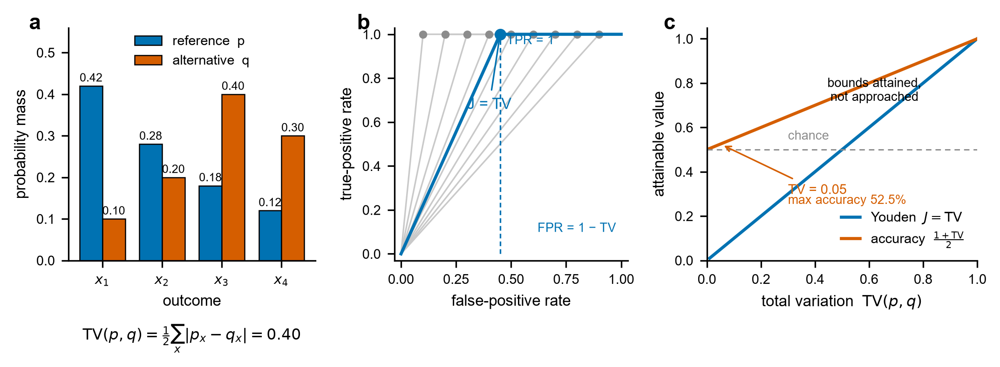
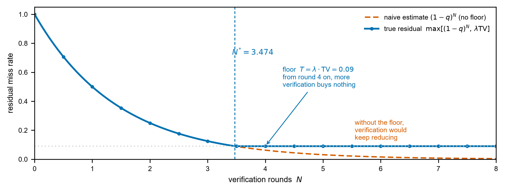
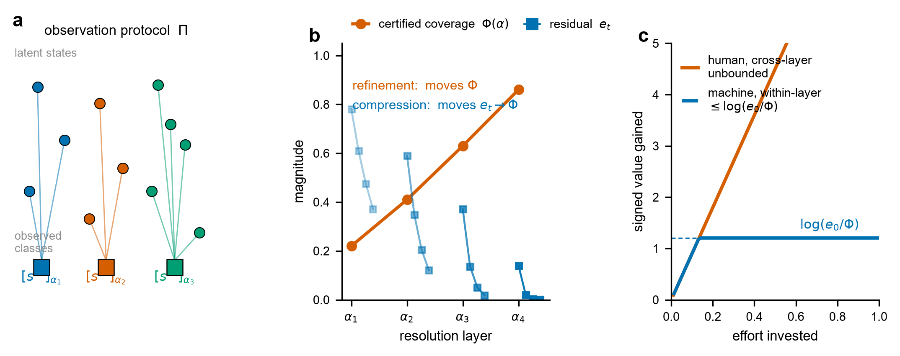
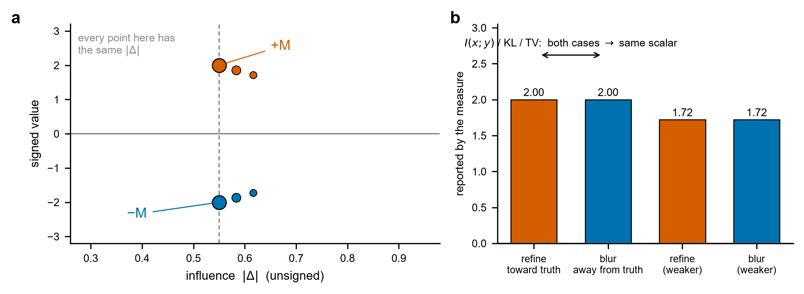
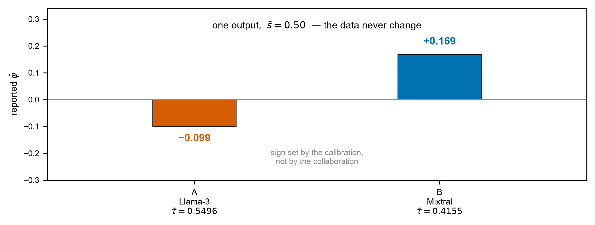

# 人的价值，不是能测出来的

> 这篇文章不讲怎么检测 AI 生成的内容。
> 它讲的是另一件事：**为什么不该用检测结果，去量一个人。**

生态学家找一种太隐蔽的鸟。查了四十次，还是没听见。
他们不会因此宣布：这片林子是空的。

---

## 一 · 它看不见全貌

检出率会随着调查次数上升，趋近 1，但**永远到不了 1**。
这叫「不完美检出」，是 MacKenzie 等人 2002 年就写进教科书的东西。

今天我们把 AI 输出当成了「观测本身」。

> 可模型输出不是观测。是一条**有分辨率上限的通道**。

最强的检测器，超出随机的多余准确率**恰好等于 TV/2**。
这不是工程没做到位 —— 这是两点引理给出的界，而且界是**取到的**，不是逼近的。

上图 (a) 的例子里 TV = 0.40，最好也就是 **70%** 准确率。
再看 (c)：TV = 0.05 时，准确率上限 **52.5%**。
那基本是在抛硬币。

那多查几遍呢？残差确实按 `(1−q)ᴺ` 往下掉——然后被一个地板**截断**。

> 最优核查轮数 `N* ≤ N₀`，而 `N₀` 的式子里**没有审稿人的可靠度**。

在这组参数下：天花板卡在 **3.474 轮**。请来再靠谱的人，也买不到下一步。
扫过的参数组里，**83.97%** 的情形下，真正卡住进度的是检测器本身，不是人。

---

## 二 · 它量错了东西

假设你真的拿到了一个读数。

人和机器的贡献，**不是同一种货币**。

| | 动的是什么 | 上限 |
|---|---|---|
| **人的贡献**（refinement） | 挪动**目标本身** Φ | 没有上限 |
| **机器的贡献**（compression） | 压缩**剩下的距离** eₜ | log(e₀/Φ) |

没有任何换算率能从前者推出后者。

---

## 三 · 影响不是价值

就算只谈「动了多少」，那也不等于「值多少」。

**图 4(b) 是全篇最该被记住的一张。**

把一个论断**推向真相**，和把一个论断**推离真相**——
KL、互信息、总变差，给出的是**完全相同的数**。

> 尺子量的是「动了多少」，不是「动对了没有」。

---

## 四 · 它连方向都定不了

这一层最要命。

主流的信息论测度 `φ = I(x;y)/I(y)`，是**完全无符号**的：里面每一样东西都是惊讶度，只有差值。
它的估计量 `φ̂ = 1 − τ̄/s̄` 更糟 —— τ̄ 不是从这次合作里量出来的，是**在外面拟合**的。

同一段输出，s̄ = 0.50。

- 标定 A（Llama-3，τ̄ = 0.5496）→ **−0.099**，几乎没人参与
- 标定 B（Mixtral，τ̄ = 0.4155）→ **+0.169**，有人参与

数据一个字都没变。**正负号是你选的。**

一把连正负都定不了的尺子，没资格用来给人定性。

---

## 五 · 所以

我们没有给出答案。

我们给出的是这句：

> **这个问题，不该用数据来回答。**

而且不是说说而已。

> **117 条 Lean 4 定理。零 sorry，零公理。**

形式化不是装饰。它证伪了我们自己写错的一个不等式，逼出了那个地板项，
推翻了两条我们以为对的单调性方向。

一个能扛过定理证明器的建模错误，大概率也扛不过一个合作者。

---

## 尾声

没检出鸟，不等于森林是空的。
但同样，没检出空地，也不等于森林是满的。

一个诚实的检测者，应该说的是：

> **「我在这儿什么都没看见。」**

而不是「这里什么都没有」。

---

*技术细节、117 条定理与 9 个模块，见正式论文 `manuscript.md` 与 `Provenance/` 下的 Lean 4 源码。*
